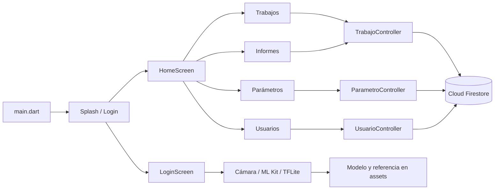

# Taller Aguileta · trabajos y reconocimiento facial

Aplicación Flutter para registrar y cotizar trabajos de rectificación de motores. Incluye informes por mes, catálogos de parámetros y usuarios, y un acceso facial experimental. Los datos de trabajos, clientes, parámetros y usuarios se consultan directamente desde Cloud Firestore.

> **Estado:** prototipo académico. El acceso local y el registro facial requieren trabajo adicional antes de utilizar datos reales. Consulta [Estado actual y límites](#estado-actual-y-límites).

## Qué contiene

| Área | Comportamiento presente en el código |
| --- | --- |
| Trabajos | Alta, consulta, edición, detalle, cambio de estado «cotizado» y eliminación con confirmación. Los importes se distribuyen entre culatas, cigüeñal, block y bielas. `Trabajos.totalapagar()` calcula el total con ISV. |
| Informes | Agrupa por mes los trabajos cotizados y muestra el total en lempiras (L). |
| Parámetros | Alta, consulta, edición y eliminación de pares nombre/valor. |
| Usuarios | Alta, consulta, edición y eliminación. El formulario abre una pantalla opcional de captura de rostro. |
| Clientes | Existen modelo, controlador, listado y formulario, aunque la pestaña no está conectada a `HomeScreen`. |
| Acceso | Una pantalla de entrada local y una opción facial que compara una captura con una imagen de referencia empaquetada. |

## Tecnologías y estructura

- **Flutter y Dart 3.8 o posterior:** interfaz, formularios y navegación.
- **Firebase Core y Cloud Firestore:** inicialización y persistencia desde el cliente. `firebase_auth` está declarado como dependencia, pero el flujo de acceso actual no lo utiliza.
- **Camera, ML Kit Face Detection y TFLite Flutter:** captura, detección, recorte y generación de embeddings faciales con MobileFaceNet.
- **SharedPreferences:** guarda la marca local de sesión y datos de `UserFaceModel` mediante `StorageService`.
- **intl, uuid y url_launcher:** fechas en español, IDs y enlace de notificación por WhatsApp desde el perfil de trabajo.

```text
lib/
├── main.dart                 # Firebase, fechas y rutas
├── controller/               # CRUD de Firestore
├── models/                   # Trabajo, cliente, parámetro, usuario y rostro
├── screens/                  # Captura y acceso facial
├── services/                 # Cámara, recorte, inferencia y almacenamiento local
└── view/                     # Acceso, pestañas, listados y formularios
```

### Flujo principal

1. `main.dart` inicializa Firebase y los formatos de fecha `es_ES`, y abre `SplashScreen`.
2. `SplashScreen` consulta la marca `logueado` de `SharedPreferences` para ir a `LoginPage` o `HomeScreen`.
3. `HomeScreen` presenta Trabajos, Informes, Parámetros y Usuarios.
4. Las pantallas llaman a sus controladores, que convierten los modelos y leen o escriben documentos en Firestore.
5. `LoginScreen` usa `CameraService`, `FaceCropService` y `FaceRecognitionService` para comparar la captura con la referencia incluida en `assets/tflite/face.jpg`. Este flujo es independiente de los rostros locales asociados a usuarios.

| Colección Firestore | Modelo | Uso |
| --- | --- | --- |
| `trabajos` | `Trabajos` | Servicios, importes, fecha y estado cotizado. |
| `clientes` | `Cliente` | Datos básicos del cliente. Su interfaz está fuera de la navegación principal. |
| `parametros` | `Parametro` | Valores de configuración en formato texto. |
| `usuarios` | `Usuario` | ID, nombre, correo y rol; estos registros no crean cuentas de Firebase Authentication. |

## Diagrama interactivo

Descarga [el visor de arquitectura](docs/arquitectura.html) y abre `docs/arquitectura.html` en un navegador. En GitHub se muestra el código HTML; los controles funcionan al abrir el archivo descargado. Puedes filtrar por área, seleccionar nodos para ver responsabilidades y archivos, y mover o acercar el grafo. El visor funciona sin conexión.



Se intentó utilizar **Noodles MCP**, pero la revisión automática rechazó el análisis local por el riesgo de enviar el código a un servicio externo. Por ello, el HTML es una **alternativa interactiva elaborada mediante lectura local del código**; no es un diagrama generado por Noodles. El diagrama Mermaid resume el flujo visible en GitHub.

## Preparación local

1. Instala Flutter con Dart 3.8 o posterior y prepara un dispositivo o emulador Android con cámara.
2. Clona el repositorio e instala las dependencias:

   ```bash
   git clone https://github.com/javierdavidortegaherrera-ui/app-ml-flutter.git
   cd app-ml-flutter
   flutter pub get
   ```

3. Configura un proyecto Firebase propio de pruebas para Android y revisa `lib/firebase_options.dart`. Define reglas de Firestore acordes con el mecanismo de autenticación que vayas a implementar. El repositorio no contiene esas reglas.
4. Ejecuta la revisión estática y la aplicación:

   ```bash
   flutter analyze
   flutter devices
   flutter run -d <id-del-dispositivo-android>
   ```

La detección facial con ML Kit y la cámara requieren un dispositivo compatible y sus permisos. Esta copia incluye el permiso de cámara en el manifiesto Android.

## Estado actual y límites

- **Acceso:** la pantalla de contraseña contiene credenciales en el cliente y `SharedPreferences` solo guarda una marca local. Esto no autentica ni autoriza el acceso a Firestore. Las reglas y una autenticación confiable son necesarias antes de usar datos reales.
- **Biometría:** el acceso facial compara con una imagen empaquetada en la app. `RegisterScreen` captura una foto, pero aún no genera ni devuelve un embedding al formulario; por tanto, el registro facial de usuarios no está completo. El archivo `FaceAntiSpoofing.tflite` tampoco participa en la comprobación actual.
- **Privacidad:** `StorageService` puede guardar embeddings en `SharedPreferences`, sin cifrado ni una política de consentimiento, retención y eliminación definida. La imagen de referencia empaquetada es accesible con la aplicación. No uses rostros reales hasta resolver ese diseño.
- **Navegación:** existen pantallas y controlador de clientes, pero `HomeScreen` no ofrece una ruta a esa pestaña.
- **Plataformas:** se conserva el proyecto Android. El flujo facial depende de plugins nativos y no se ha verificado para web ni escritorio.
- **Verificación:** el repositorio no contiene pruebas automatizadas. En este entorno faltan paquetes en la caché local, así que `flutter analyze` y la ejecución en dispositivo siguen pendientes.

## Autor

**Javier David Ortega Herrera** · Proyecto académico de Ingeniería en Informática, CEUTEC, Honduras.
